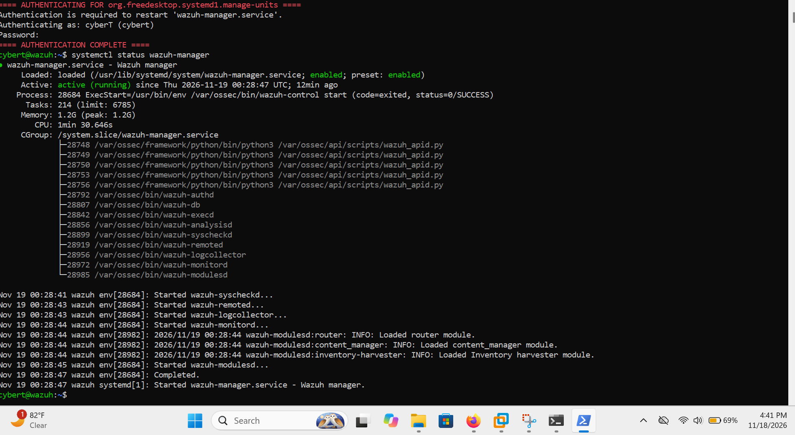
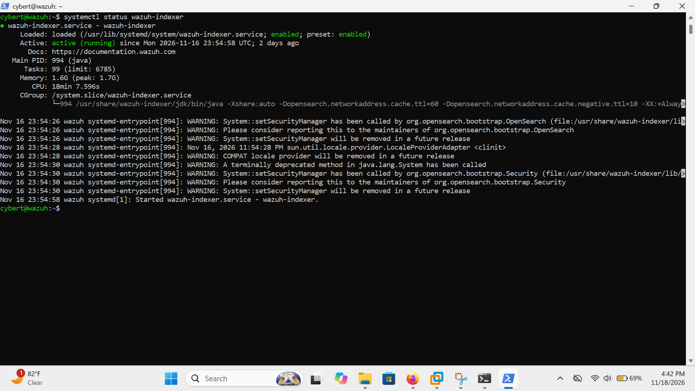
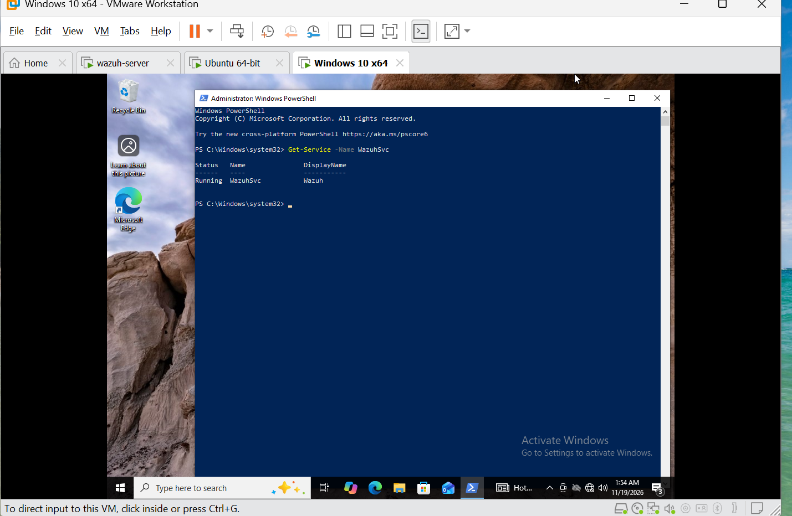
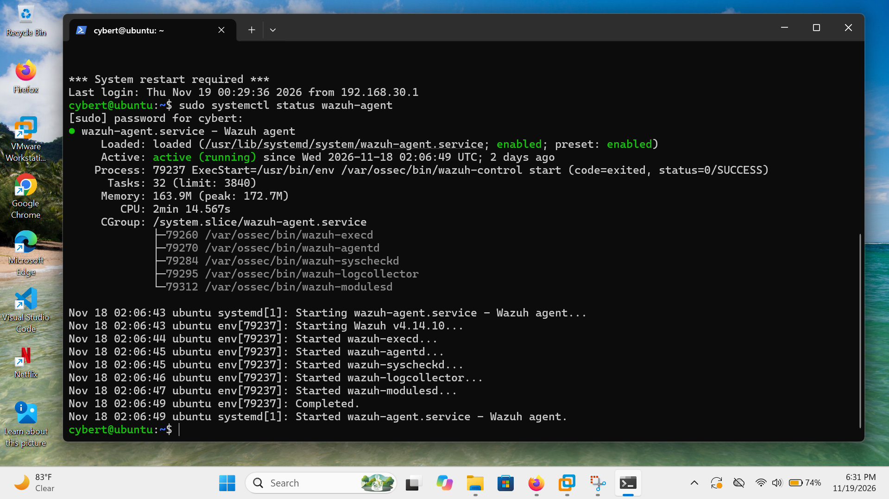
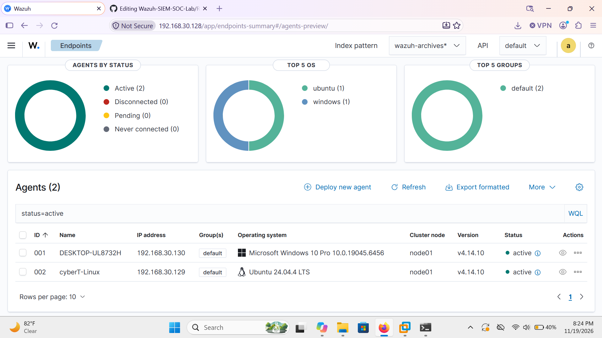
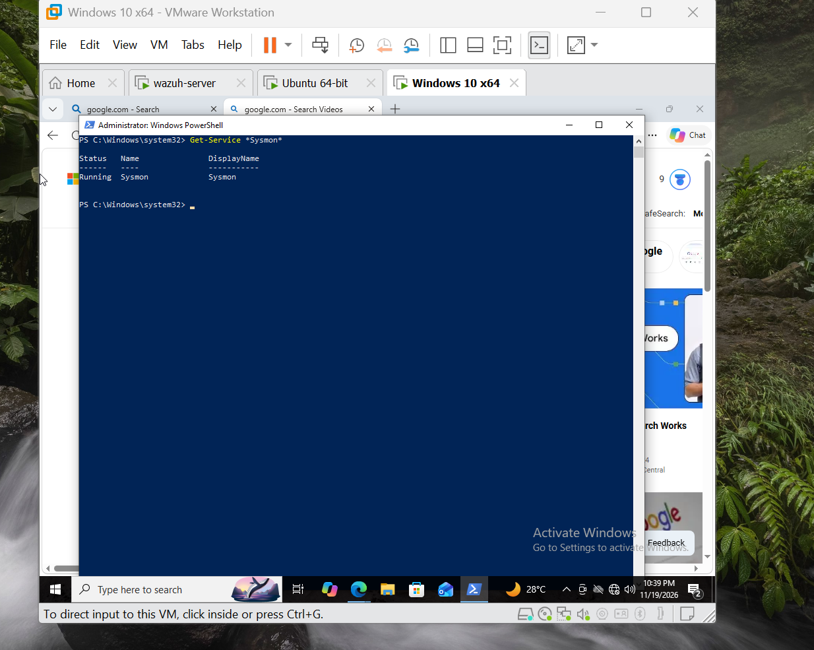
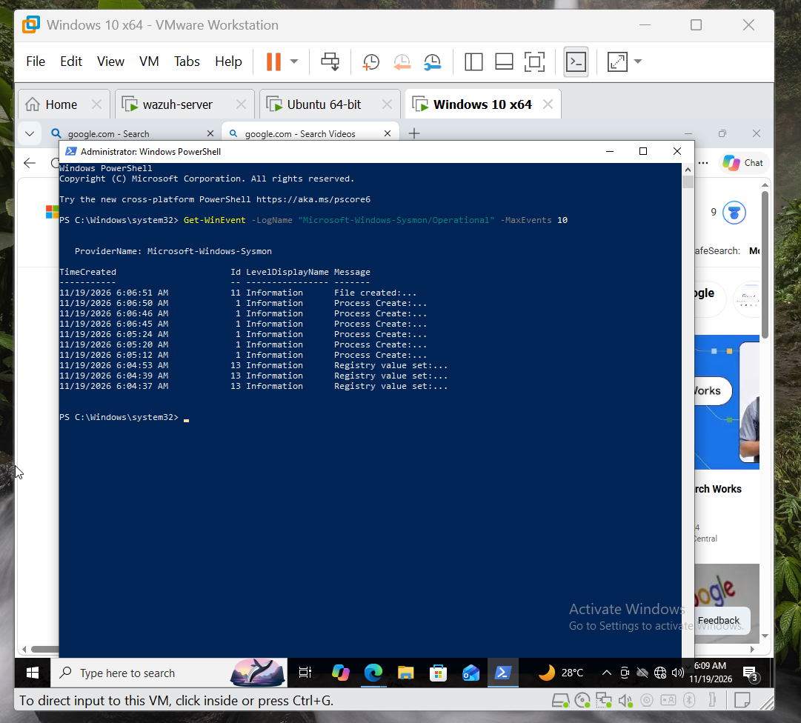

# Wazuh-SIEM-SOC-Lab
## Project Overview
This project documents the deployment and configuration of a Wazuh Security Information and Event Management (SIEM) environment for hands-on Security Operations Center (SOC) training.

The lab focuses on endpoint security monitoring, log collection, threat detection, security event analysis and incident investigation

## Project Objectives
- Deploy and configure Wazuh SIEM.
- Integrate Windows and Linux endpoints.
- Collect and analyze security event logs.
- Configure Windows Sysmon for enhanced monitoring.
- Investigate failed authentication attempts.
- Develop custom security detection rules.
- Practice SOC alert triage and incident investigation.

## Lab Environment

| Component  |  Technology |
--------------|---------------|
| SIEM Platform | Wazuh     |
| SIEM Server  | Ubuntu Server |
| Virtualization | VMware |
| Windows Endpoint | Windows 10 |
| Linux Endpoint | Ubuntu Linux Endpoint |
| Endpoint Monitoring | Wazuh Agent |
| Windows Telemetry | Sysmon |
| Log Analysis | Wazuh Dashboard |

## Implementation

The project documentation will cover the following:

### Phase 1: Wazuh Server Deployment and Verification
### Wazuh Manager Service Verification
After deploying the Wazuh manager on Ubuntu, I verified that the service was running successfully.

**Command executed:**
```bash
sudo systemctl status wazuh-manager
```
***Verification Results:**
- Wazuh Manager service was active and running.
- The service was enabled.
- Wazuh analysis engine processes were running.
- Wazuh log collector processes were running.
- Wazuh API processes were running.
  
**Evidence:**



**Security Relevance:**

The Wazuh Manager is responsible for processing security events collected from monitored endpoints and evaluating them against configured detection rules. 
Verifying its operational status is an important step in maintaining a functional SIEM environment.

---

### 1.2 Wazuh Indexer Verification 
The Wazuh Indexer provides the storage and indexing capabilities required to search and analyze security event data.

**Command Executed:**
```bash
sudo systemctl status wazuh-indexer
```

**Verification Results:**
- The Wazuh Indexer service was active and running.
- The service was enabled to start automatically.
- The Java-based indexing process was running.
- The service reported a successful startup.
- Java/OpenSearch deprecation warnings were observed, but the service remained active.

**Screenshot Evidence:**



**Security Relevance:**
The Wazuh Indexer stores and indexes security information generated with the SIEM environment. This allows the efficient search of historical events, investigation suspicious activity, and a performance of security analysis.

---

### 1.3 Wazuh Dashboard Verification
The Wazuh dashboard provides the graphical interface used to monitor security events, analyze alerts, and investigate endpoint activity.

**Command Executed:**
```bash
sudo systemctl status wazuh-dashboard
```

**Verification Results:**
- The Wazuh Dashboard service was active and running.
- The service was enabled to start automatically.
- The Node.js dashboard process was running.
- Dashboard logs displayed successful HTTP responses with status code 200.

**Sreenshot Evidence:**


**Security Relevance:**
The Wazuh Dashboard provides a centralized interface for security monitoring and investigation. It allows the review of security alerts, observation of endpoint activities and visualization of security information collected across the monitored environment.

---

### 1.4 Ifrastructure Verification Summary
The operational status of the three core Wazuh SIEM  components was verified using the `systemctl` utility.
| Component | Operating System | Service Status |
|-----------|------------------|----------------|
|Wazuh Manager | Ubuntu Server | Active (running) |
|Wazuh Indexer | Ubuntu Server | Active (running) |
|Wazuh Dashboard | Ubuntu Server | Active (running) |

**Outcome:**
All three core Wazuh services were confirmed to be running during verification.
This establishes the Operational foundation for subsequent endpoint integration, security event collection, threat detection and incident investigation activities.

**Note:** Service-level verification does not independently confirm indexer cluster health, agent connectivity or end to end event ingestion. These capabilities will be validated in subsequent project phases.

---


### Phase 2: Endpoint Integration and Verification
### Overview
The second phase of this project focused on deploying and verifying Wazuh agents on Windows 10 and Ubuntu Linux virtual machines hosted within a VMware environment.
The objective was to integrate multiple endpoints into the centralized Wazuh Security Information and Event Management (SIEM) infrastructure.
Wazuh agents are responsible for collecting endpoint security telemetry and forwarding relevant information to the Wazuh Manager for analysis, monitoring and threat detection.
Two operating systems were integrated into the SIEM environment:
- Windows 10: Windows security monitoring and event collection.
- Ubuntu Linux: Linux system monitoring and security log collection.
---
### 2.1 Windows 10 Wazuh Agent Deployment
### Objective 
Deploy and configure the Wazuh agent on a windows 10 virtual machine to enable centralized endpoint security monitoring.
### Implementation 
The Windows 10 endpoint was deployed within VMware and configured to communicate with the centralized Wazuh Manager.
The implementation involved:

1. Installing the Wazuh agent on the Windows 10 endpoint.
2. Configuring the Wazuh Manager IP address.
3. Starting the Wazuh agent service.
4. Verifying the agent's operational status.
5. Preparing the endpoint for centralized security event collection.

### Agent Service Verification
Windows Powershell was used to verify that the Wazuh agent service was operational.
**Command Executed:**
```bash
Get-Service -Name WazuhSvc
```
  
   The Running status confirms that the Wazuh agent service is operational on the Windows 10 endpoint.

   #### Screenshot Evidence


#### Security Relevance
Deploying the Wazuh agent on a Windows endpoint provides the foundation for:
- Monitoring Windows authentication events.
- Detecting suspicious login attempts.
- Monitoring user account activities.
- Collecting Windows security event logs.
- Identifying potential end point security threats.
- Supporting security incident investigations.
This integration enables Windows endpoint telemetry to be collected and analyzed through the centralized SIEM infrastructure.
---

### 2.2 Ubuntu Linux Wazuh Agent Deployment 
#### Objective
Deploy and configure the Wazuh agent on an Ubuntu Linux virtual machine to enable centralized monitoring of Linux system activities.

#### Implementation 
The Ubuntu Linux endpoint was deployed within VMware and configured to communicate with the Wazuh Manager.
The implementation involved:
1. Installing the Wazuh agent on the Ubuntu endpoint.
2. Configuring the Wazuh Manager connection.
3. Starting the Wazuh agent service.
4. Verifying the operational status of the agent.
5. Preparing the Linux endpoint for centralized security monitoring.

#### Agent Service Verification
The Linux system service manager was used to verify the Wazuh agent.

**Command Executed:**
```bash
sudo systemctl status wazuh-agent
```

#### Expected Verification Result:
         Active: active (running)
         
The active (running) status confirms that the Wazuh agent service is operational on the Ubuntu Linux endpoint. 

#### Screenshot Evidence


The Ubuntu Linux terminal displaying the operational status of the Wazuh agent was logged in through SSH on the host machine.

#### Security Relevance 
Deploying the Wazuh agent on a Linux endpoint provides the foundation for:
- Monitoring Linux authentication events.
- Detecting suspicious SSH login attempts.
- Monitoring system security logs.
- Identifying unauthorized system modifications.
- Collecting Linux security telemetry.
- Supporting threat detection and incident investigation.
This integration extends centralized security monitoring across multiple operating systems.
---

### 2.3 Endpoint Integration Architecture
#### Overview
The Wazuh SIEM infrastructure consists of a centralized Wazuh Server and two monitored endpoints.
The Wazuh Server contains three primary components:
- Wazuh Manager
- Wazuh Indexer
- Wazuh Dashboard
The Windows 10 and Ubuntu Linux endpoints communicates with the Wazuh Manager through their installed Wazuh agents.
#### Architecture
      +------------------------------------------------------------------------+
      |                          WAZUH  SERVER                                 |
      |------------------------------------------------------------------------|
      |  Wazuh Manager                                                         |
      |  Wazuh Indexer                                                         |
      |  Wazuh Dashboard                                                       |
      +------------------------------------------------------------------------|
                                   ^
                                   |
                         Agent Communication
                                   |
                        +----------+-----------+
                        |                      |
                        |                      |
              +-----------------+       +---------------+
              | Windows 10      |       | Ubuntu Linux  |
              | Endpoint        |       |               |
              |-----------------|       |---------------|
              | Wazuh Agent     |       | Wazuh Agent   |
              +-----------------+       +---------------+

### 2.4 Agent Connectivity Verification
#### Objective 
Verify successful communication between the Windows 10 and Ubuntu Linux endpoints and centralized Wazuh Manager.

### Verification Procedure 
Agent connectivity can be verified through the Wazuh Dashboard.
Verification steps:
1. Access the Wazuh Dashboard.
2. Navigate to the endpoint or agent management section.
3. Locate the registered Windows 10 endpoint.
4. Located the registered Ubuntu Linux endpoint.
5. Verify that both endpoints display an Active connection status.

#### Screenshot Evidence

Wazuh Dashboard Displaying registered and connected endpoints.

#### Security Relevance
Agent connectivity verification is essential for maintaining visibility across monitored endpoints.
Disconnected agents may prevent the ability to receive the current endpoint security telemetry.
Verifying agent connectivity helps ensure that monitored systems remain visible within the centralized SOC environment.

---
### Phase 3: Windows Sysmon Integration 
#### Overview
The third phase of this project focused on implementing advanced Windows endpoint monitoring using Microsoft Sysmon (Sysmon Monitor) and integrating its security telemetry with the Wazuh Security Information and Event Management (SIEM) infrastructure.
Sysmon is a Windows system service that provides detailed visibility into system activities, including process execution, file creation, registry modifications, and other security-relevant events.
The primary objectives of this phase were:

- Install and configure Microsoft Sysmon on the Windows 10 virtual machine.
- Enable detailed Windows endpoint security monitoring
- Configure the Wazuh agent to collect Sysmon security events.
- Verify Sysmon event generation using Windows PowerShell.
- Identify and analyze security-relevant Sysmon event IDs.
- Prepare endpoint telemetry for centralized monitoring within wazuh
---

#### 3.1 Sysmon Installation and Configuration
Microsoft Sysmon was installed on the Windows 10 virtual machine to enhance endpoint security monitoring capabilities.
Sysmon provides detailed system activity information that can assist in detecting suspicious behaviour and investigating potential security incidents.
The installation was performed on the Windows 10 endpoint already integrated with the Wazuh SIEM infrastructure.

**Sysmon Monitoring Capabilities:**
- Process creation and execution monitoring.
- File creation monitoring.
- Windows registry modification tracking.
- Process execution metadata collection.
- Network connection monitoring when enable.
- Detailed Windows endpoint activity logging.

#### Sysmon Service Verification:
**Executed Command:**
```bash
Get-Service *Sysmon*
```
**Screenshot Evidence:**


#### Security Relevance: 
Sysmon enhances endpoint visibility by collecting detailed system activity information.
This telemetry can assist in identifying suspicious processes, unauthorized applications, malicious Scripts, and potentially malicious system modifications.

---
#### 3.2 Sysmon Event Log Verification
After configuring Sysmon, I verified that the Windows endpoint was successful generating security events.
The verification was performed using Windows Powershell with administartive priviledges.

**Command Executed:**
```bash
Get-WinEvent -LogName "Microsoft-Windows-Sysmon/Operational" -MaxEvents 10
```

**Verification Results:**
The PowerShell output confirmed that Sysmon was actively generating Windows security events.
The following event IDs were obsereved:
- Event ID 1: Process Creation.
- Event ID 11: File Creation.
- Event ID 13: Registry Value Set.
The generated security events contained information including:
- Event timestamps.
- Event identifiers.
- Event providers.
- Event description
- Event severity levels.

**Screenshot Evidence:**


**Security Relevance:**
Sysmon Event ID 1 provides visibility into process execution and can help identify suspicious command-line activities.
Sysmon Event ID 11 records file creation activities that may be relevant during malware investigations.
Sysmon Event ID 13 records registry value modification that may indicate suspicious system changes or potential persistence mechanisms.
These events provide valuable telemetry for security monitoring and incident investigation.

---

#### 3.3 Wazuh Agent Configuration for Sysmon Integration
The Wazuh agent installed on the Windows 10 endpoint was configured to collect security events generated by Microsoft Sysmon.
The Wazuh agent configuration file is located at:
```text
C:\Program Files (x86)\ossecc-agent\ossec.conf
```

**Executed Command:**
```bash
notepad "C:\Program Files (x86)\ossec-agent\ossec.conf"
```
**Sysmon Event Collection Configuration:**
The following XML configuration was included within the existing Wazuh agent configuration:
```xml
<localfile>
  <location>Microsoft-Windows-Sysmon/Operational</location>
  <log_format>eventchannel</log_format>
</localfile>
```

**Configuration Explanation:**
- Location: Specifies the Windows Event Log channel containing Sysmon security events.
- Log Format: Configures the Wazuh agent to collect events using the Windows Event Channel format.
This configuration allows the Wazuh agent to collect Sysmon security telemetry and forward it to the Wazuh Manager for processing.

**Screenshot Evidence:**


### Phase 4: Security Event Monitoring 
Monitoring Windows authentication events, account activity and other security events.

### Phase 5: Custom Detection Rules 
Creating and testing Wazuh detection rules for suspicious security activities.

### Phase 6: Security Investigation 
Analyzing security alerts and documenting investigation findings

## Project Screenshots 
Screenshots demonstrating the implementation, configuration and security monitoring activities will be added as the project documentation.

