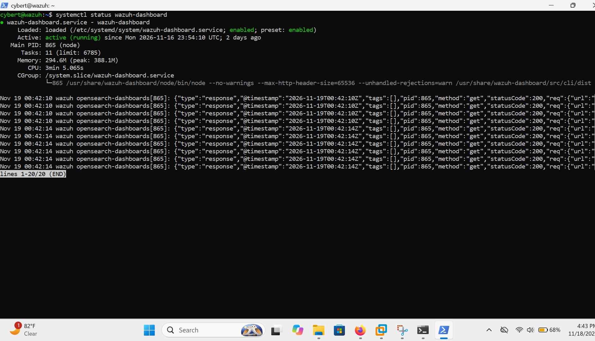

# Wazuh-SIEM-SOC-Lab
## Project Overview
This project documents the deployment and configuration of a Wazuh Security Information and Event Management (SIEM) environment for hands-on Security Operations Center (SOC) training.

The lab focuses on endpoint security monitoring, log collection, threat detection, security event analysis and incident investigation

## Project Objectives
- Deploy and configure Wazuh SIEM.
- Integrate Windows and Linux endpoints.
- Collect and analyze security event logs.
- Configure Windows Sysmon for enhanced monitoring.
- Investigate failed authentication attempts.
- Develop custom security detection rules.
- Practice SOC alert triage and incident investigation.

## Lab Environment

| Component  |  Technology |
--------------|---------------|
| SIEM Platform | Wazuh     |
| SIEM Server  | Ubuntu Server |
| Virtualization | VMware |
| Windows Endpoint | Windows 10 |
| Linux Endpoint | Ubuntu Linux Endpoint |
| Endpoint Monitoring | Wazuh Agent |
| Windows Telemetry | Sysmon |
| Log Analysis | Wazuh Dashboard |

## Implementation

The project documentation will cover the following:

### Phase 1: Wazuh Server Deployment and Verification
### Wazuh Manager Service Verification
After deploying the Wazuh manager on Ubuntu, I verified that the service was running successfully.

**Command executed:**
```bash
sudo systemctl status wazuh-manager
```
***Verification Results:**
- Wazuh Manager service was active and running.
- The service was enabled.
- Wazuh analysis engine processes were running.
- Wazuh log collector processes were running.
- Wazuh API processes were running.
  
**Evidence:**


**Security Relevance:**

The Wazuh Manager is responsible for processing security events collected from monitored endpoints and evaluating them against configured detection rules. 
Verifying its operational status is an important step in maintaining a functional SIEM environment.

---

### 1.2 Wazuh Indexer Verification 
The Wazuh Indexer provides the storage and indexing capabilities required to search and analyze security event data.

**Command Executed:**
```bash
sudo systemctl status wazuh-indexer
```

**Verification Results:**
- The Wazuh Indexer service was active and running.
- The service was enabled to start automatically.
- The Java-based indexing process was running.
- The service reported a successful startup.
- Java/OpenSearch deprecation warnings were observed, but the service remained active.

**Screenshot Evidence:**


**Security Relevance:**
The Wazuh Indexer stores and indexes security information generated with the SIEM environment. This allows the efficient search of historical events, investigation suspicious activity, and a performance of security analysis.

---

### 1.3 Wazuh Dashboard Verification
The Wazuh dashboard provides the graphical interface used to monitor security events, analyze alerts, and investigate endpoint activity.

**Command Executed:**
```bash
sudo systemctl status wazuh-dashboard
```

**Verification Results:**
- The Wazuh Dashboard service was active and running.
- The service was enabled to start automatically.
- The Node.js dashboard process was running.
- Dashboard logs displayed successful HTTP responses with status code 200.

**Sreenshot Evidence:**



**Security Relevance:**
The Wazuh Dashboard provides a centralized interface for security monitoring and investigation. It allows the review of security alerts, observation of endpoint activities and visualization of security information collected across the monitored environment.

---

### 1.4 Ifrastructure Verification Summary
The operational status of the three core Wazuh SIEM  components was verified using the `systemctl` utility.
| Component | Operating System | Service Status |
|-----------|------------------|----------------|
|Wazuh Manager | Ubuntu Server | Active (running) |
|Wazuh Indexer | Ubuntu Server | Active (running) |
|Wazuh Dashboard | Ubuntu Server | Active (running) |

**Outcome:**
All three core Wazuh services were confirmed to be running during verification.
This establishes the Operational foundation for subsequent endpoint integration, security event collection, threat detection and incident investigation activities.

**Note:** Service-level verification does not independently confirm indexer cluster health, agent connectivity or end to end event ingestion. These capabilities will be validated in subsequent project phases.

---


### Phase 2: Endpoint Integration and Verification
### Overview
The second phase of this project focused on deploying and verifying Wazuh agents on Windows 10 and Ubuntu Linux virtual machines hosted within a VMware environment.
The objective was to integrate multiple endpoints into the centralized Wazuh Security Information and Event Management (SIEM) infrastructure.
Wazuh agents are responsible for collecting endpoint security telemetry and forwarding relevant information to the Wazuh Manager for analysis, monitoring and threat detection.
Two operating systems were integrated into the SIEM environment:
- Windows 10: Windows security monitoring and event collection.
- Ubuntu Linux: Linux system monitoring and security log collection.
---
### 2.1 Windows 10 Wazuh Agent Deployment
### Objective 
Deploy and configure the Wazuh agent on a windows 10 virtual machine to enable centralized endpoint security monitoring.
### Implementation 
The Windows 10 endpoint was deployed within VMware and configured to communicate with the centralized Wazuh Manager.
The implementation involved:

1. Installing the Wazuh agent on the Windows 10 endpoint.
2. Configuring the Wazuh Manager IP address.
3. Starting the Wazuh agent service.
4. Verifying the agent's operational status.
5. Preparing the endpoint for centralized security event collection.

### Agent Service Verification
Windows Powershell was used to verify that the Wazuh agent service was operational.
**Command Executed:**
```bash
Get-Service -Name WazuhSvc
```
Expected verification result:
   Status     Name      DisplayName
   ------     ----      -----------
   Running    WazuhSvc  Wazuh
   
   The Running status confirms that the Wazuh agent service is operational on the Windows 10 endpoint.

   #### Screenshot Evidence


### Phase 3: Windows Sysmon Integration 
Configuration of Sysmon to collect detailed Windows telemetry.

### Phase 4: Security Event Monitoring 
Monitoring Windows authentication events, account activity and other security events.

### Phase 5: Custom Detection Rules 
Creating and testing Wazuh detection rules for suspicious security activities.

### Phase 6: Security Investigation 
Analyzing security alerts and documenting investigation findings

## Project Screenshots 
Screenshots demonstrating the implementation, configuration and security monitoring activities will be added as the project documentation

